# Complete paper result gallery

[中文](https://tianchen-ai.github.io/triton-weft-bench/zh-CN/paper/gallery/) · [CSV tables and provenance](README.md) · [Reproduce the experiments](https://tianchen-ai.github.io/triton-weft/experiments/reproduce/) · [Triton–Weft](https://github.com/Tianchen-ai/triton-weft)

Weft makes data representation, local arithmetic, shared preparation and state
programmable, then uses their relationships to construct CPU execution. This
gallery follows that argument: first the resulting performance, then the author
choices and source reuse, and finally the compiler mechanisms that turn those
choices into machine code.

All **12 result figures (paper Figures 9–20), comprising 23 SVG panels**, appear
below. Click a panel to inspect its vector source. Each group links its matching
measurements; [provenance](provenance.json) records the source revision and hashes.

## Performance across operators and applications

### Native operators

**Figure 9.** Across **543 matched comparisons**, per-target geometric-mean
speedups over optimized references range from **1.32× to 1.83×**. The heatmap
shows representative computation roles; the cumulative distributions include
every matched case.

| Representative kernels | All matched cases |
|---|---|
| [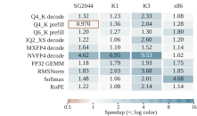](operators-heatmap.svg) |  |

| CPU | Cases | Matched comparisons | Geometric-mean speedup |
|---|---:|---:|---:|
| SG2044 · RVV128 | 133 | 132 | **1.60×** |
| K1/X60 · RVV256 and IME | 137 | 136 | **1.54×** |
| K3/A100 · RVV1024 and IME2 | 136 | 135 | **1.83×** |
| Xeon Platinum 8470Q · AVX-512/VNNI/AMX | 147 | 140 | **1.32×** |

Ratios are reference/Weft native latency. GGML supplies 541 references and
oneDNN two. `scope` distinguishes complete calls from prepared-operand
microkernels. Data: [all operators](operators.csv), [family summaries](operator-families.csv).

### Vector and matrix execution

**Figure 10.** Prepared-operand microkernels expose how generated execution uses
x86 VNNI/AMX and RISC-V IME/IME2. Each ratio compares the same native workload
on one CPU; blue denotes prefill and hatched gray decode.

| x86 | RISC-V |
|---|---|
| [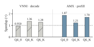](hardware-x86.svg) | [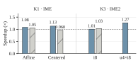](hardware-riscv.svg) |

Data: [operators.csv](operators.csv), with target, implementation and timing scope.

### FP32 GEMM against optimized libraries

**Figure 11.** Complete single-thread FP32 GEMM on Xeon 8470Q compares Weft
with GGML, OpenBLAS and oneDNN at `M×N×K = 128×4096×4096` and `512×512×512`.
Per-call packing is included. Markers give geometric means of two independent
process ratios; segments show their range.

[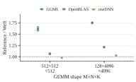](fp32-libraries.svg)

Data: [fp32-libraries.csv](fp32-libraries.csv).

### Complete calls on multiple CPU cores

**Figure 12.** A native CPU grid distributes independent output regions across
1, 2, 4 and 8 Xeon 8470Q cores. Curves report absolute latency, including
preparation. Bottom ratios compare the reference with Weft at each thread count.
References are GGML for GEMM/projection and blocked C/OpenMP for Welford.

| Dense multiplication | Complete Q4_K projection | Welford statistics |
|---|---|---|
| [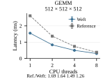](threads-gemm_f32.svg) | [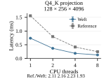](threads-q4_k_projection_prefill.svg) | [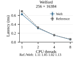](threads-welford.svg) |

Markers give means of independent process medians; error bars show their range.
Data: [grid.csv](grid.csv).

### Complete llama.cpp inference

**Figure 13.** Kernel composition accelerates complete prefill and decode,
including graph execution, activation processing and thread scheduling. The
eight model/platform deployments include a K3 vendor IME2 reference; a second
K3 CPU-vector comparison is shown separately. Blue is prefill, hatched gray decode.

[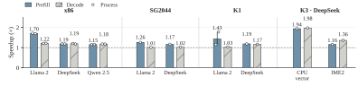](models.svg)

SG2044 uses **64 threads**; x86, K1 and K3 use **eight**. SG2044/K1/x86 measure
128-token prefill and 32-token decode after a 512-token context. K3 measures
32-token prefill and eight-token decode after a 32-token context. Each pair uses
the same model, weights, shapes and worker count. Bars aggregate per-process
median ratios; points and ranges show independent processes when available.

Data: [all application phases](applications.csv), [x86 stage windows](application-x86-windows.csv),
[computation/preparation role measurements](application-roles.csv).

### Computation inside GGML worker execution

**Figure 20, appendix.** Replacing matrix computation within the same GGML graph
and worker team connects generated kernels to application execution. Both sides
use the same Weft activation quantizer. Timing includes common preparation and
graph execution at `N=256, K=4096` on Xeon 8470Q.

| Decode, M=1 | Prefill, M=128 |
|---|---|
| [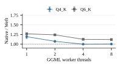](integrated-decode.svg) | [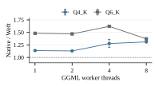](integrated-prefill.svg) |

Points give geometric means of paired process ratios and whiskers their range.
Data: [ggml-compute.csv](ggml-compute.csv).

## Author control, composition and reuse

### Five routes for the same control tasks

**Figure 14.** Intrinsic C, Triton CPU, Exo 2, TensorIR and Weft implement
local/shared preparation crossed with direct/grouped accumulation. All compute
the complete Q4_K or Q6_K projection, including activation quantization, at
`M=1,16,128`, `N=256`, `K=4096` on x86. Ratios use intrinsic C local/direct at
each shape as the reference. The panels show the effect of each source choice
and its resulting execution.

[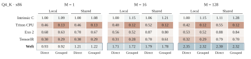](routes-q4.svg)

[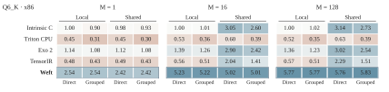](routes-q6.svg)

Data: [author-controls.csv](author-controls.csv), [selected bindings](five-route-bindings.csv),
[first construction and Q6 increment](format-addition.csv).

### Arithmetic organization and output state

**Figure 15.** Holding the compiler, row/column binding, preparation scope and
four-product width fixed, the author can change how coefficients and partials
form a whole-block expression and how long output state lives. Bars compare
these organizations with subgroup traversal. Complete calls include activation
quantization; bars aggregate two process ratios, with each ratio shown as a point.

| Q4_K | Q6_K |
|---|---|
| [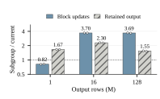](organization-q4.svg) | [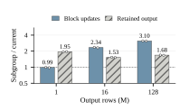](organization-q6.svg) |

Data: [author-organization.csv](author-organization.csv). This experiment changes
author organization; the compiler studies below hold it fixed.

### Author choices across CPU targets

**Figure 16.** The same model exposes preparation scope and local numerical
grouping across CPU targets. Each row is normalized to its own Weft local/direct
program. Columns select local/shared preparation and direct/grouped accumulation.

[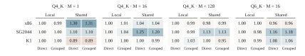](weft-controls.svg)

Data: [author-controls.csv](author-controls.csv).

### Source increments and reuse

**Figure 17.** MXFP4, NVFP4 and IQ2_XXS are introduced through dequantization and
then dot. Encoding and decoder definitions established by the first operator
are reused by the second. Bars distinguish newly added code from the definitions
reused by dot. Both operators together add **68, 79 and 60 SLOC**, respectively;
dot reuses **6, 6 and 28 SLOC** of the definitions already introduced.

Data: [per-format SLOC](increment-costs.csv), [measured definitions](increment-definitions.csv).
The [five-route source table](format-addition.csv) records Q4_K construction and
Q6_K addition in tokens. These are separate source measures: this figure counts
normalized SLOC for new format/operator definitions. The
[actual format and kernel sources](https://github.com/Tianchen-ai/triton-weft/tree/main/python/triton/kernels/weft/ggml)
and [reuse model](https://tianchen-ai.github.io/triton-weft/programming-model/)
show their structure.

Online attention and Welford test composition with different state dependencies:
maximum/normalizer/output updates in attention, and count/mean/second central
moment in streaming statistics. [state-algorithms.csv](state-algorithms.csv)
records sequential and blocked complete-call times, bindings and references.

## Compiler mechanisms under fixed source semantics

### Encoding, forwarding and matrix state

**Figure 18.** Source relationships guide physical construction. Field geometry
enables direct decoding of saved arrays; value uses enable array forwarding;
state scopes enable fragment retention. Each intervention fixes the author
program, Canonical operations/types/regions, inputs and target options, then
disables one physical mechanism.

| Encoding and consumption | Value forwarding and matrix state |
|---|---|
| [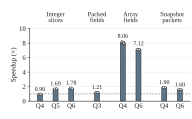](encoding-consumption.svg) | [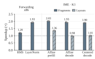](values-state.svg) |

Bars give geometric means of disabled/full latency ratios across two processes.
Dots show process ratios and whiskers their paired-batch interquartile ranges.
Data: [compiler-mechanisms.csv](compiler-mechanisms.csv).

### Source bounds through target construction

**Figure 19.** The declared grouped result and source field bounds permit exact
wide arithmetic. RISC-V uses those bounds to construct wide execution; x86
propagates them through instruction selection to remove redundant conversions.
Both panels fix the source and Canonical program at `N=256, K=4096`.

| RISC-V range-guided execution | x86 source-range propagation |
|---|---|
| [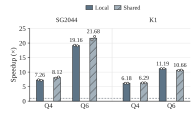](range-proof.svg) | [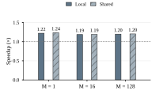](source-ranges.svg) |

Ratios compare disabled/enabled complete-call latency. Bars aggregate two process
ratios. RISC-V dots and whiskers show process ratios and paired-batch interquartile
ranges. Data: [compiler-mechanisms.csv](compiler-mechanisms.csv).

## Reproduce and inspect

Start with the [installation guide](../install.md), [quickstart](../quickstart.md)
and [full paper workflow](https://tianchen-ai.github.io/triton-weft/experiments/reproduce/).
Bench owns workloads, references, checks and timing; the installed
[Triton–Weft product](https://github.com/Tianchen-ai/triton-weft) supplies the
compiler, runtime and normal kernel library. The [data guide](README.md) links all
16 CSVs and explains their columns. [Provenance](provenance.json) maps every
panel to the final paper source and records its exact hash.
