# 完整论文结果图集

[English](https://tianchen-ai.github.io/triton-weft-bench/paper/gallery/) · [CSV 与来源](README.zh-CN.md) · [实验复现](https://tianchen-ai.github.io/triton-weft/zh/experiments/reproduce/) · [Triton–Weft](https://github.com/Tianchen-ai/triton-weft)

Weft 让数据表示、局部算术、共享准备和状态成为可编程对象，编译器利用它们的关系
构造 CPU 执行。本图集沿着这一论证展开：先看最终性能，再看作者选择与源码复用，
最后看这些选择如何通过编译机制变成机器代码。

以下完整收录 **12 幅结果图（论文图 9–20），共 23 个 SVG 面板**。
点击图片可查看矢量源文件，各组图旁链接对应数据；[来源清单](provenance.json)
记录源版本和哈希。

## 算子与应用性能

### 原生算子

**图 9。** 在 **543 项匹配对照**上，各平台相对优化参考的几何平均加速为
**1.32–1.83×**。热图展示代表性计算，累积分布包含全部匹配案例。

| 代表算子 | 全部匹配案例 |
|---|---|
|  |  |

| CPU | 案例数 | 匹配对照 | 几何平均加速 |
|---|---:|---:|---:|
| SG2044 · RVV128 | 133 | 132 | **1.60×** |
| K1/X60 · RVV256 与 IME | 137 | 136 | **1.54×** |
| K3/A100 · RVV1024 与 IME2 | 136 | 135 | **1.83×** |
| Xeon Platinum 8470Q · AVX-512/VNNI/AMX | 147 | 140 | **1.32×** |

倍率为参考／Weft 原生耗时。GGML 提供 541 项参考，oneDNN 提供两项。
`scope` 区分完整调用和使用预备操作数的微内核。
数据：[全部算子](operators.csv)、[类别汇总](operator-families.csv)。

### 向量与矩阵执行

**图 10。** 使用预备操作数的微内核展示生成执行对 x86 VNNI/AMX 和 RISC-V IME/IME2
的利用。每个倍率比较同一 CPU 上相同的原生工作负载；蓝色表示 prefill，灰色斜线表示 decode。

| x86 | RISC-V |
|---|---|
| [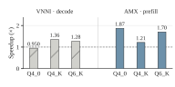](hardware-x86.svg) | [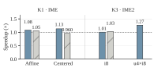](hardware-riscv.svg) |

数据：[operators.csv](operators.csv)，包括目标、实现和计时范围。

### FP32 GEMM 与优化库

**图 11。** 在 Xeon 8470Q 上比较 Weft、GGML、OpenBLAS 与 oneDNN 的完整单线程 FP32
GEMM，形状为 `M×N×K = 128×4096×4096` 和 `512×512×512`。
每次调用的打包计入耗时。点为两个独立进程倍率的几何平均，线段表示范围。

[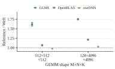](fp32-libraries.svg)

数据：[fp32-libraries.csv](fp32-libraries.csv)。

### 多核完整调用

**图 12。** 原生 CPU grid 将独立输出区域分配到 1、2、4、8 个 Xeon 8470Q 核心。
曲线给出包含准备工作的绝对耗时，底部倍率比较相同线程数下的参考与 Weft。
GEMM／投影参考为 GGML，Welford 参考为分块 C/OpenMP。

| 稠密乘法 | 完整 Q4_K 投影 | Welford 统计 |
|---|---|---|
| [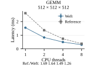](threads-gemm_f32.svg) | [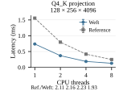](threads-q4_k_projection_prefill.svg) | [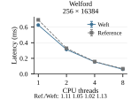](threads-welford.svg) |

点为独立进程中位数的均值，误差线表示范围。数据：[grid.csv](grid.csv)。

### 完整 llama.cpp 推理

**图 13。** 内核组合加速包含图执行、激活处理与线程调度的完整 prefill 和 decode。
八组模型／平台部署中，K3 使用厂商 IME2 参考，另行展示 K3 CPU 向量参考。
蓝色为 prefill，灰色斜线为 decode。

SG2044 使用 **64 线程**，x86、K1、K3 使用 **八线程**。
SG2044／K1／x86 测量 128-token prefill，以及 512-token context 后的 32-token decode；
K3 测量 32-token prefill，以及 32-token context 后的 8-token decode。
每对比较固定模型、权重、形状与工作线程数。柱聚合各进程的中位数倍率；
有多个独立进程的部署同时展示点和范围。

数据：[全部应用阶段](applications.csv)、[x86 阶段窗口](application-x86-windows.csv)、
[计算／准备角色测量](application-roles.csv)。

### GGML 工作线程中的计算

**图 20，附录。** 在同一 GGML 图与工作线程组中替换矩阵计算，将生成内核连接到应用执行。
双方使用同一个 Weft 激活量化器，计时包含公共准备与图执行，
Xeon 8470Q 上固定 `N=256, K=4096`。

| Decode，M=1 | Prefill，M=128 |
|---|---|
| [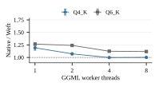](integrated-decode.svg) | [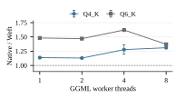](integrated-prefill.svg) |

点为配对进程倍率的几何平均，误差线表示范围。数据：[ggml-compute.csv](ggml-compute.csv)。

## 作者控制、组合与复用

### 五条路线实现相同控制任务

**图 14。** Intrinsic C、Triton CPU、Exo 2、TensorIR 与 Weft 实现局部／共享准备与
直接／分组累加的组合。所有程序在 x86 上计算完整 Q4_K 或 Q6_K 投影，包括激活量化，
固定 `M=1,16,128`、`N=256`、`K=4096`。
各形状以 intrinsic C 局部／直接版本为参考，展示源程序控制和生成执行的效果。

[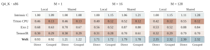](routes-q4.svg)

[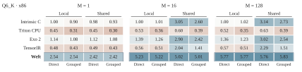](routes-q6.svg)

数据：[author-controls.csv](author-controls.csv)、[选定绑定](five-route-bindings.csv)、
[首次构造与新增 Q6](format-addition.csv)。

### 算术组织与输出状态

**图 15。** 固定编译器、行列绑定、准备范围和四乘积分组，作者可以改变系数与部分和
如何形成整块表达式，以及输出状态存在多久。柱将这些组织与子组遍历比较，
完整调用包含激活量化；柱聚合两个进程倍率，点展示各进程结果。

| Q4_K | Q6_K |
|---|---|
| [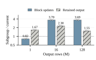](organization-q4.svg) | [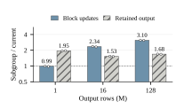](organization-q6.svg) |

数据：[author-organization.csv](author-organization.csv)。这里改变作者组织，
后文编译器研究固定作者组织。

### 跨 CPU 目标的作者选择

**图 16。** 同一模型在不同 CPU 上表达准备范围和局部数值分组。
每行以该目标自身的 Weft 局部／直接程序为参考；四列选择局部／共享准备与直接／分组累加。

[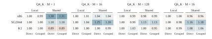](weft-controls.svg)

数据：[author-controls.csv](author-controls.csv)。

### 源码增量与复用

**图 17。** MXFP4、NVFP4、IQ2_XXS 先加入反量化，再加入 dot。
第一个算子建立的 Encoding 与解码器定义继续服务第二个算子，柱分别展示新增源码，
底部列出 dot 复用的定义。两个算子合计分别新增 **68、79、60 SLOC**，
dot 分别复用已有定义中的 **6、6、28 SLOC**。

数据：[各格式 SLOC](increment-costs.csv)、[被测定义](increment-definitions.csv)。
[五路线源码表](format-addition.csv)用 token 记录 Q4_K 构造与新增 Q6；
本图用规范化 SLOC 记录新格式／算子定义，两者是不同的源码度量。
[实际格式和内核源码](https://github.com/Tianchen-ai/triton-weft/tree/main/python/triton/kernels/weft/ggml)与
[复用模型](https://tianchen-ai.github.io/triton-weft/zh/programming-model/)给出对应结构。

在线注意力和 Welford 进一步检验不同状态依赖的组合：前者耦合最大值、归一化和与输出，
后者组合计数、均值和二阶中心矩。[state-algorithms.csv](state-algorithms.csv)
记录顺序／分块完整调用的耗时、绑定及参考。

## 固定源语义的编译机制

### Encoding、转发与矩阵状态

**图 18。** 字段几何支持保存数组的直接解码，值使用关系支持数组转发，状态范围支持
矩阵片段保留。每次干预固定作者程序、Canonical 运算／类型／区域、输入和目标选项，
关闭一项物理机制。

| Encoding 与消费 | 值转发与矩阵状态 |
|---|---|
| [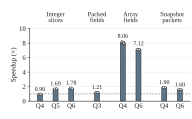](encoding-consumption.svg) | [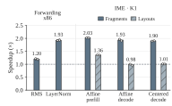](values-state.svg) |

柱为两个进程关闭／完整延迟倍率的几何平均，点为各进程倍率，线段为配对批次四分位范围。
数据：[compiler-mechanisms.csv](compiler-mechanisms.csv)。

### 数值范围贯穿目标构造

**图 19。** 分组结果的类型与源字段范围共同支持精确宽算术：RISC-V 据此构造宽执行，
x86 将这些范围贯穿指令选择，消除多余转换。两图均固定源程序与 Canonical，
采用 `N=256, K=4096`。

| RISC-V 范围引导执行 | x86 源范围传播 |
|---|---|
| [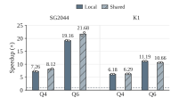](range-proof.svg) | [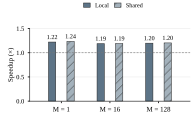](source-ranges.svg) |

倍率比较关闭／开启后的完整调用耗时，柱聚合两个进程倍率；RISC-V 的点和线段展示
各进程倍率及配对批次四分位范围。数据：[compiler-mechanisms.csv](compiler-mechanisms.csv)。

## 复现与查看

从[安装指南](../install.zh-CN.md)、[快速开始](../quickstart.zh-CN.md)及
[完整论文复现流程](https://tianchen-ai.github.io/triton-weft/zh/experiments/reproduce/)开始。
Bench 提供工作负载、参考、检查和计时；安装后的
[Triton–Weft 产品](https://github.com/Tianchen-ai/triton-weft)提供编译器、运行时和正常内核库。
[数据指南](README.zh-CN.md)链接全部 16 份 CSV 并解释列含义，
[来源清单](provenance.json)将每个面板映射回最终论文源并记录精确哈希。
